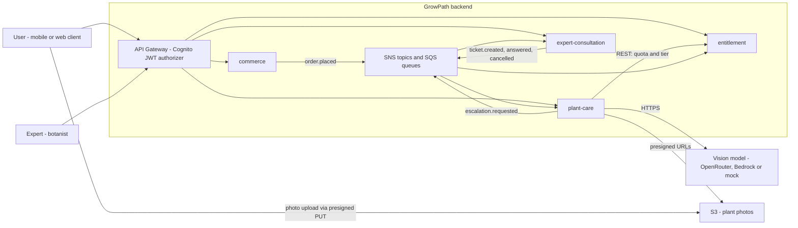
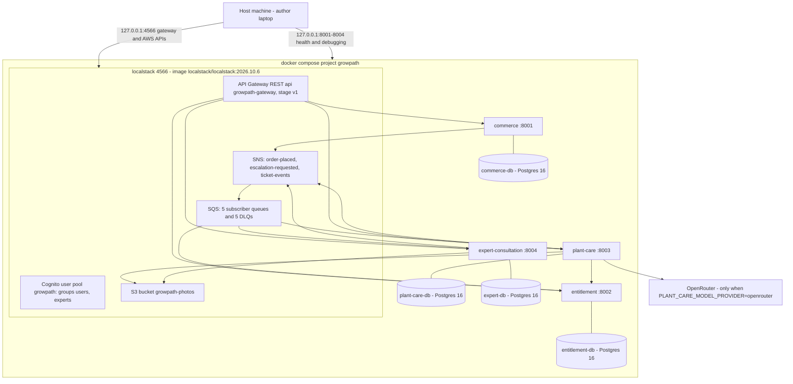
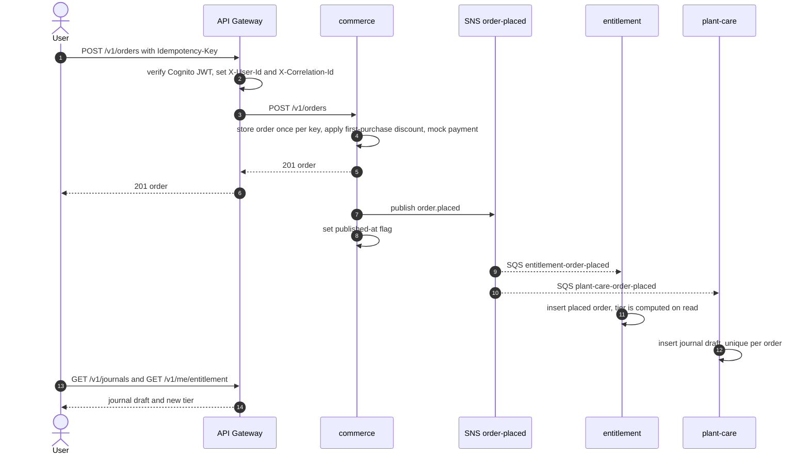
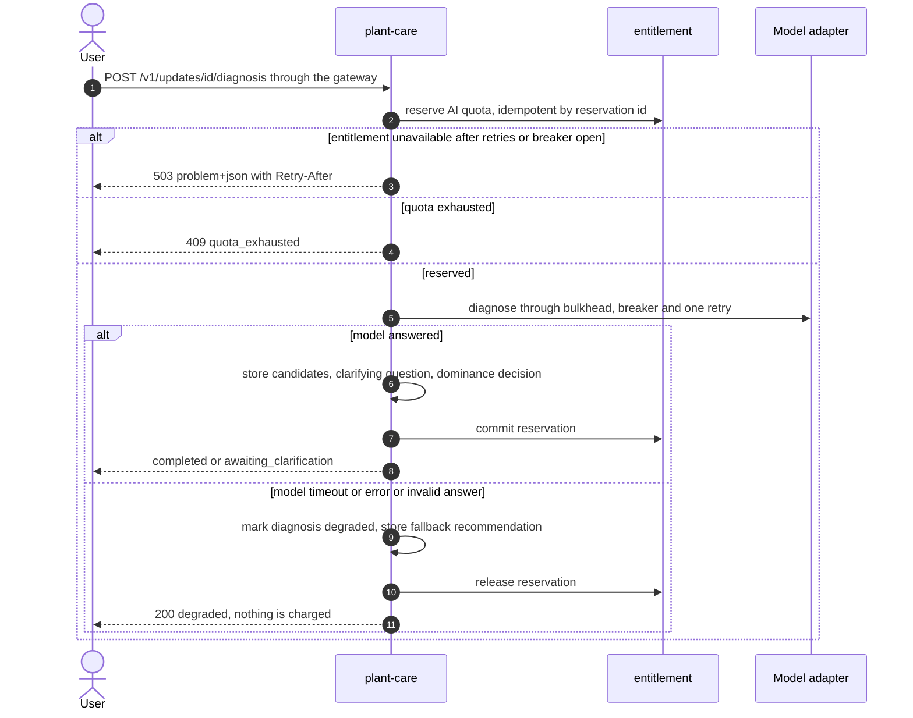
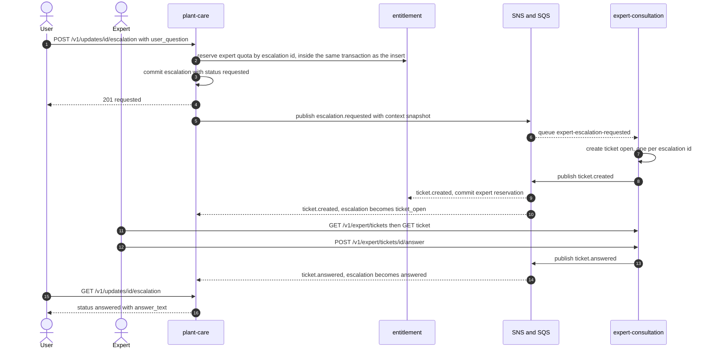
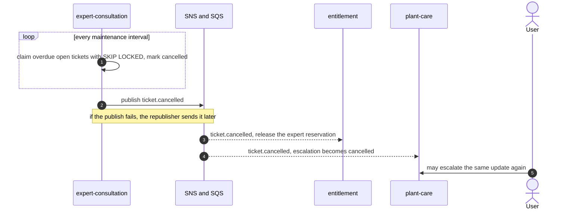

# GrowPath backend architecture

This document describes the microservice architecture that the code in this repository implements.
Every claim points to a file you can open. For how to run the stack and where each requirement is
implemented, see the [README](../README.md); for the call script see [demo-script.md](demo-script.md).

Contents: [1. Context](#1-context) | [2. Deployment](#2-deployment-docker-compose-and-localstack) |
[3. Decomposition](#3-decomposition-rationale) | [4. Synchronous interaction](#4-synchronous-interaction) |
[5. Asynchronous interaction](#5-asynchronous-interaction) | [6. Sequence diagrams](#6-sequence-diagrams) |
[7. Resilience](#7-resilience) | [8. Security and identity](#8-security-and-identity) |
[9. Observability](#9-observability) | [10. Contracts](#10-contracts) | [11. Deliberate omissions](#11-deliberate-omissions)

## 1. Context

GrowPath sells a physical starter pack (seeds, optionally a soil sensor), keeps a plant journal for
each pack, diagnoses plant problems with a multimodal AI model, and lets a user escalate to a live
botanist. Two kinds of people use the backend: a **user** and an **expert** (a Cognito group).



## 2. Deployment (docker-compose and LocalStack)

The whole system starts with `make up` (`docker compose up -d --build --wait`, see
[`docker-compose.yml`](../docker-compose.yml)). Four service containers, four PostgreSQL containers and one
LocalStack container, all on the default compose network. Only loopback ports are published.



| Container | Port on 127.0.0.1 | Notes |
|---|---|---|
| `localstack` | 4566 | API Gateway, Cognito, SNS, SQS, S3 (`SERVICES=apigateway,cognito-idp,sns,sqs,s3,sts,iam`). Provisioned at start by [`infra/localstack/init/ready.d/01-provision.sh`](../infra/localstack/init/ready.d/01-provision.sh) |
| `commerce` | 8001 | Alembic migrations and catalog seed run at container start (see `services/commerce/Dockerfile`) |
| `entitlement` | 8002 | |
| `plant-care` | 8003 | Also seeds the care knowledge base from `services/plant-care/knowledge/` |
| `expert-consultation` | 8004 | |
| `*-db` | not published | Each Postgres has its own database, role and password (from `.env`); nothing but its owner service can reach it by design |

The service ports exist for health checks and debugging; the product API is reached through the gateway:
`http://localhost:4566/restapis/<api-id>/v1/_user_request_/v1/<path>` on LocalStack. On real AWS the
`<api-id>` URL is replaced by the API Gateway invoke URL or a custom domain, and the services stay private
(Pod Identity or OIDC supplies AWS access; the code uses the default AWS credential chain and never reads
keys, see the comment in `docker-compose.yml`).

## 3. Decomposition rationale

There are four business services. Each owns a capability, its data and the rules that change together.

| Service | Capability | Owns (own database) | Why it is a separate service |
|---|---|---|---|
| `commerce` | Catalog, orders, mocked payment, first-purchase discount | `catalog_items`, `catalog_item_labels`, `orders` | Money-handling consistency (an order is stored once per idempotency key, one discount per user) with its own release rhythm. It must keep working at checkout even when every other service is down |
| `entitlement` | Account tier and AI / expert quotas | `placed_orders` (a projection of paid orders), AI and expert quota reservations | A policy engine with its own concurrency model: reserve, commit and release under row locks. The tier is **not stored**: it is a function of the paid total of the last 30 days |
| `plant-care` | Plant journal, updates, photos, AI diagnosis, escalation, care chat | 10 tables: journals, updates, photos, diagnoses, escalations, knowledge base, chat | The core domain and the only service with a slow, unreliable dependency (the AI model). It isolates that dependency behind an adapter, a breaker and a bulkhead |
| `expert-consultation` | Expert tickets and their state machine, the expert role | `tickets`, `answers` | A different actor (the botanist) and a different lifecycle (open, answered, or expired). It works from a **snapshot** of the context carried by the event, so it never calls plant-care |

**Data ownership.** One PostgreSQL database per service, with its own role and password. There are no
foreign keys across services: an id from another service is a plain `uuid` column. A service never reads
another service's database. The only data that crosses a boundary is an API response or an event.

**What is deliberately not shared.**

- No shared database and no cross-service transactions (no 2PC, no saga framework). Cross-service
  consistency is eventual and goes through events (section 5).
- No shared library with business logic. The only shared package is
  [`libs/observability`](../libs/observability/src/growpath_observability), an infrastructure module for
  JSON logging and correlation-ID handling.
- No shared domain model: a service keeps the projection it needs. `entitlement` stores paid orders
  (`placed_orders`) from `order.placed` instead of calling commerce.

**Why Commerce and Entitlement are separate.**

1. *Different reasons to change.* Catalog, pricing and discounts change with marketing; tier thresholds and
   quota ceilings change with product policy. They are decided independently and are configuration of
   different services (`services/entitlement/app/config.py`).
2. *Different consistency needs.* An order is a single insert. A quota unit is a reservation that must not be
   over-committed under concurrency; `entitlement` solves that with row locks and conditional updates. Putting both
   in one service would couple the checkout path to quota contention.
3. *Different availability.* `plant-care` asks `entitlement` on the hot path of every diagnosis. If tier and quota
   lived inside commerce, a checkout outage would stop diagnoses, and quota traffic would load the order database.
   With the split, commerce is off the diagnosis path entirely (the chain is gateway, plant-care, entitlement).
4. *Cost of the split is small.* They share one fact, "an order was paid", which is exactly one event
   (`order.placed`). The trade-off is eventual consistency of a few hundred milliseconds between a purchase and
   the new tier; the demo polls for it.

**Alternatives considered.** A monolith would remove the distributed concerns but not demonstrate them, and
would put the AI dependency in the same failure domain as checkout. Merging commerce and entitlement was
rejected for the reasons above. A separate notification or auth service was not added: notifications are not
business logic here, and authentication is delegated to Cognito.

## 4. Synchronous interaction

REST over HTTP, versioned under `/v1`, errors as RFC 7807 `application/problem+json`.

- **Client to service:** every request goes through the gateway ([section 8](#8-security-and-identity)).
- **Service to service:** a single edge, `plant-care` to `entitlement` (reserve, commit and release AI quota;
  reserve and release expert quota; read the tier). The call chain is gateway, plant-care, entitlement: two
  services, below the limit of three. `entitlement` calls nobody.
- The client is [`services/plant-care/app/quota.py`](../services/plant-care/app/quota.py). Every call carries
  the `X-Correlation-Id` and is bounded by timeouts, a retry with jitter and a circuit breaker
  (section 7). Every quota call is safe to repeat: reserve is idempotent by reservation id, commit and
  release are terminal and answer the same way when repeated.
- The quota endpoints are internal (`x-gateway: internal` in
  [`contracts/openapi/entitlement.yaml`](../contracts/openapi/entitlement.yaml)) and are not routed by the gateway.

## 5. Asynchronous interaction

SNS topics at the publisher, one SQS queue (with a dead-letter queue) per subscriber, raw message delivery.
The event type travels in the `event_type` message attribute, the correlation ID in `correlation_id`.
Provisioning: [`infra/localstack/init/ready.d/01-provision.sh`](../infra/localstack/init/ready.d/01-provision.sh).
The event contract is [`contracts/asyncapi/growpath-events.yaml`](../contracts/asyncapi/growpath-events.yaml) (AsyncAPI 3.0).

| Topic | Event | Publisher | Subscriber queue | Filter policy | DLQ |
|---|---|---|---|---|---|
| `order-placed` | `order.placed` | commerce | `entitlement-order-placed` | none | `order-placed-dlq` |
| `order-placed` | `order.placed` | commerce | `plant-care-order-placed` | none | `plant-care-order-placed-dlq` |
| `escalation-requested` | `escalation.requested` | plant-care | `expert-escalation-requested` | none | `expert-escalation-requested-dlq` |
| `ticket-events` | `ticket.created`, `ticket.answered`, `ticket.cancelled` | expert-consultation | `entitlement-ticket-events` | `event_type` in `ticket.created`, `ticket.cancelled` | `entitlement-ticket-events-dlq` |
| `ticket-events` | same | expert-consultation | `plant-care-ticket-events` | none (plant-care shows the whole ticket lifecycle) | `plant-care-ticket-events-dlq` |

What each event does:

- `order.placed`: entitlement stores the paid order (the tier follows from the 30-day sum); plant-care creates a
  journal **draft** for the pack's plant species.
- `escalation.requested`: carries a snapshot of the context the expert needs (species, questionnaire, photo keys,
  the user's question, a diagnosis summary, recent history); expert-consultation opens a ticket from it.
- `ticket.created`: entitlement commits the expert quota reservation; plant-care marks the escalation `ticket_open`.
- `ticket.answered`: plant-care shows the answer to the user.
- `ticket.cancelled` means "the ticket expired": entitlement returns the expert quota, plant-care frees the update
  for a new escalation.

**Delivery guarantees.**

- *Publishing is at-least-once.* There is no outbox table. The row carries its own state and a repeater resends:
  commerce marks `orders` with a "published at" flag and `OrderRepublisher` resends unflagged orders after a grace
  period; expert-consultation does the same for terminal ticket events (`TicketMaintenance`); plant-care's
  `status = requested` is itself the "not yet confirmed" marker and `EscalationRepeater` resends it until a ticket
  confirms it or the reservation TTL ends. Batches are claimed with `FOR UPDATE SKIP LOCKED`.
- *Consuming is idempotent.* A message is deleted from the queue only after its handler succeeded
  (`QueueConsumer._process` in each service's `service/consumer.py`). Handlers are idempotent through business keys
  and conditional writes (`INSERT ... ON CONFLICT DO NOTHING` on `order_id`, `escalation_id`, update id; guarded
  `UPDATE ... WHERE status = ...` for state changes). There is no `processed_events` table.
- *Failures go to the DLQ.* A message whose handler raises stays in the queue; SQS redelivers it and moves it to the DLQ
  after `maxReceiveCount`. The local queues use a 1 s visibility timeout and `maxReceiveCount = 2` so the demo is quick;
  production values would be larger.
- Delivery to a down subscriber is buffered by SQS: the demo stops `expert-consultation` and shows the event waiting
  (`./scripts/demo.sh resilience`, act 5b).

## 6. Sequence diagrams

### 6.1 Purchase: order.placed to journal draft and tier



The same request with the same `Idempotency-Key` returns the existing order with `200`. If SNS is down the order is
still paid and returned; the republisher publishes the event later.

### 6.2 Diagnosis: AI quota reserve, commit or release, degraded fallback



Creating an update already reserves one AI unit (see `UpdateService.submit` in
`services/plant-care/app/service/updates.py`); if entitlement is down at that moment the update is still stored with
the `diagnosis_pending` fallback and is paid for when the diagnosis later runs. The reservation id is generated per
attempt and stored in `diagnoses.ai_reservation_id`; a released reservation is terminal, so a retry takes a new id.

### 6.3 Escalation: expert quota, escalation.requested, ticket, answer



If `expert-consultation` is down, steps 5 onward wait: the event stays in its SQS queue, and while no ticket confirms the
escalation the plant-care repeater republishes it every 30 s. The consumer creates only one ticket per escalation
id, so the duplicates are harmless.

### 6.4 Ticket expiry: ticket.cancelled and quota release



The ticket TTL is 72 hours from creation (`EXPERT_CONSULTATION_TICKET_TTL_SECONDS=259200`, an author's assumption, not an
SLA), so expiry is not shown in the live demo. It is covered by `services/expert-consultation/tests/unit/test_maintenance.py`
and the DB tests in `services/expert-consultation/tests/db/`. The only reason a ticket is cancelled is expiry; there is no
user cancellation.

## 7. Resilience

| Mechanism | Where in the code | Behaviour and configuration |
|---|---|---|
| Timeouts on every outgoing call | HTTP to entitlement: [`quota.py`](../services/plant-care/app/quota.py) `create_entitlement_client` (`PLANT_CARE_ENTITLEMENT_CONNECT_TIMEOUT_SECONDS` 1 s, `..._READ_TIMEOUT_SECONDS` 5 s). Model: `model_connect_timeout_seconds`, `model_timeout_seconds` in [`plant-care config.py`](../services/plant-care/app/config.py). AWS SDK: `Config(connect_timeout, read_timeout)` in each `messaging/sns.py` and `sqs.py` | All values come from settings, not constants in code |
| Retries with jitter | [`resilience.py`](../services/plant-care/app/resilience.py) `retry_with_jitter` (random delay up to `base * 2^(n-1)`, capped). Used by `EntitlementClient._send` (2 attempts) and `ModelGuard` (2 attempts). Boto3 clients use `retries={"mode": "standard"}` (exponential backoff with jitter) | Only repeatable calls are retried: quota calls are idempotent by design |
| Circuit breaker | `CircuitBreaker` in `resilience.py`: closed, open after N consecutive failures, one half-open probe after the reset timeout. One instance for entitlement (5 failures, 10 s), one for the model (5 failures, 30 s) | Logs `circuit breaker opened` and `entitlement call rejected by the open breaker`. Shown live in act 5a of the demo |
| Bulkhead on the model | [`llm/guard.py`](../services/plant-care/app/llm/guard.py) `ModelGuard`: a non-blocking `BoundedSemaphore` (`model_bulkhead_size`, 4). A full bulkhead fails at once instead of queueing | A slow model cannot hold all request threads. Settings validation forces the bulkhead to be at least `diagnosis_samples` |
| Fallbacks | Model failure: diagnosis becomes `degraded` with a fixed recommendation and the AI reservation is released (`DiagnosisService._degrade` in [`service/diagnosis.py`](../services/plant-care/app/service/diagnosis.py)). Entitlement down at submit time: update stored as `diagnosis_pending` (`service/updates.py`). Chat: `sources_only` answer | No user data is lost and no quota is spent on a failed model call |
| `503` with `Retry-After` | [`api/errors.py`](../services/plant-care/app/api/errors.py) `unavailable_handler` (`PLANT_CARE_UNAVAILABLE_RETRY_AFTER_SECONDS`, 5). Same pattern in expert-consultation, and entitlement answers `503` + `Retry-After` on a quota lock timeout | A client gets a precise retry hint instead of a hang |
| Idempotent consumers | `ON CONFLICT DO NOTHING` and guarded updates in `services/*/app/repository/` (for example `placed_orders.py`, `journals.py`, `tickets.py`); message deleted only after a successful handler (`service/consumer.py`) | Duplicate and reordered events are safe |
| Published-at flag plus repeater instead of an outbox table | `OrderRepublisher` ([commerce](../services/commerce/app/service/republisher.py)), `TicketMaintenance` ([expert-consultation](../services/expert-consultation/app/service/maintenance.py)), `EscalationRepeater` ([plant-care](../services/plant-care/app/service/escalation_repeater.py)) | Grace periods, batch sizes and intervals are settings. Delivery is at-least-once |
| Dead-letter queues | `maxReceiveCount = 2` on every subscriber queue ([provisioning](../infra/localstack/init/ready.d/01-provision.sh)). Shown live in act 5c | A poison message ends in the DLQ instead of blocking the queue |
| Idempotent writes at the edge | `Idempotency-Key` on `POST /v1/orders`; client-chosen id on `POST /journals/{id}/updates`; repeating `POST .../escalation` returns the active escalation | Safe client retries |
| Lazy expiry of reservations | A quota reservation occupies quota only while `expires_at` is in the future (AI 5 minutes, expert 24 hours) | A crashed caller cannot leak quota forever |

Health: every service has `/health/live` (process is up, used by the Docker health check) and `/health/ready`. `ready`
checks the service's database (`SELECT 1`) and, for services that consume queues (entitlement, plant-care,
expert-consultation), that the SQS queues answer. commerce only publishes, so its readiness checks the database.

## 8. Security and identity

- **Authentication at the gateway.** Every route uses a Cognito user pool authorizer (`COGNITO_USER_POOLS`).
  A request without a token or with a garbage token gets `401` from the gateway and never reaches a service.
- **Identity headers are derived, not trusted.** On every route the gateway maps verified claims onto request headers:
  `X-User-Id` from `sub`, `X-User-Groups` from `cognito:groups`, `X-Correlation-Id` from `$context.requestId`
  (`IDENTITY_HEADERS` in `01-provision.sh`). A mapped header replaces whatever the client sent. The demo shows a user
  forging `X-User-Groups: experts` and getting `403`, and forging `X-User-Id` and still receiving their own data.
- **Caveat: the `users` group.** The gateway overwrites a header only when the claim has a value. A token with no
  `cognito:groups` claim would let a forged `X-User-Groups` through, so provisioning puts every user (the expert too)
  in the `users` group, and the demo creates its user the same way. See Known limitations in the README.
- **Authorization in services.** Services read `X-User-Id` and `X-User-Groups`. Expert endpoints require the `experts`
  group (`403` otherwise). The user id for entitlement is taken from the token (`/v1/me/entitlement` maps
  `context.authorizer.claims.sub` into the path), never from the URL, because the entitlement service serves any id it is asked for.
- **Services are not publicly exposed.** In production they have no public address; the gateway is the only entry. Locally their
  ports are bound to `127.0.0.1`, the databases are not published, and the internal quota API of entitlement has no gateway route
  (the gateway answers `403` for it; checked by `make verify` and demo act 1).
- **Secrets.** No secret is in the repository. The LocalStack token, database passwords and the model API key come from `.env`
  (git-ignored; [`.env.example`](../.env.example) lists names only). Settings classes use `pydantic-settings` with `SecretStr` and
  no defaults for secrets. The AWS values in compose are LocalStack's dummy credentials.
- **Rate limiting.** A stage-level throttle is declared on the gateway (2 requests per second, burst 2). LocalStack stores it but does not
  enforce it, so a `429` cannot be demonstrated locally; on real API Gateway the same configuration returns `429`. There is no
  service-side `429` today. See Known limitations in the README.

## 9. Observability

- **Logs:** JSON, one object per line on stdout, from the shared formatter
  [`libs/observability/.../logging.py`](../libs/observability/src/growpath_observability/logging.py). Every record has `timestamp`,
  `level`, `service`, `logger`, `message` and `correlation_id`; extra fields (`event_type`, `call`, `status`, `duration_ms`, ids) are added
  per event. Outgoing HTTP calls and event publications are logged with the correlation ID. Secrets and personal data are not logged.
- **Correlation ID.** The gateway puts `$context.requestId` into `X-Correlation-Id`. The middleware
  ([`correlation.py`](../libs/observability/src/growpath_observability/correlation.py)) reuses it (or mints one) and echoes it in the response.
  `plant-care` forwards it on HTTP calls to entitlement and in the `correlation_id` SNS attribute; consumers read that attribute and set the
  ID for the handler, so it survives the broker. Events that originate in a background loop (republishers) use the entity id (order or escalation
  id) as correlation ID.
- **Centralization** is the single `docker compose logs` stream, filtered by correlation ID. No log shipper or dashboard is deployed (left for
  the Cloud criterion).

Follow one request across services:

```bash
docker compose --env-file .env logs --no-color --no-log-prefix --since 10m \
  | jq -Rr --arg id "<correlation-id>" 'fromjson? | select(.correlation_id == $id) | [.timestamp, .service, .message] | @tsv'
```

`./scripts/demo.sh escalation` prints this view for the escalation request: entitlement, plant-care and expert-consultation, with commerce
absent. The correlation ID of any gateway call is in its `X-Correlation-Id` response header.

**Distributed tracing is consciously not implemented** (no OpenTelemetry, Jaeger or X-Ray). Correlation IDs in structured logs cover request
following in this scope; tracing is left for later.

## 10. Contracts

- REST: one OpenAPI 3.1 file per service in [`contracts/openapi/`](../contracts/openapi), generated from the FastAPI apps. Every operation carries
  `x-gateway: public|internal`. Errors are `application/problem+json`.
- Events: [`contracts/asyncapi/growpath-events.yaml`](../contracts/asyncapi/growpath-events.yaml) (AsyncAPI 3.0): channels, queues, DLQs, attributes
  and JSON Schema payloads, written by hand.
- Contract tests (`services/*/tests/unit/test_contracts.py`, `test_event_contracts.py`) check that the committed OpenAPI equals what the app
  generates, that real responses validate against it, and that published and consumed event payloads validate against the AsyncAPI schemas.
  Details: [`contracts/README.md`](../contracts/README.md).

## 11. Deliberate omissions

Distributed tracing, an auth service (Cognito instead), a notification service, a service mesh, an outbox table, a saga framework, RabbitMQ or
Kafka, and observability dashboards. Real AWS is not used by this repository; everything AWS-shaped runs on LocalStack.
